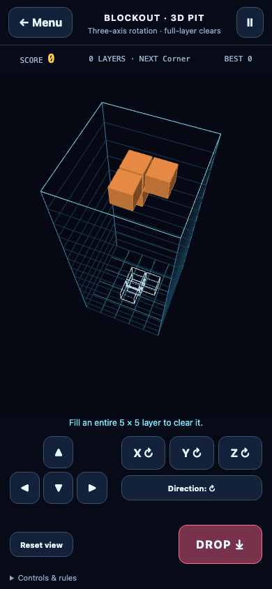
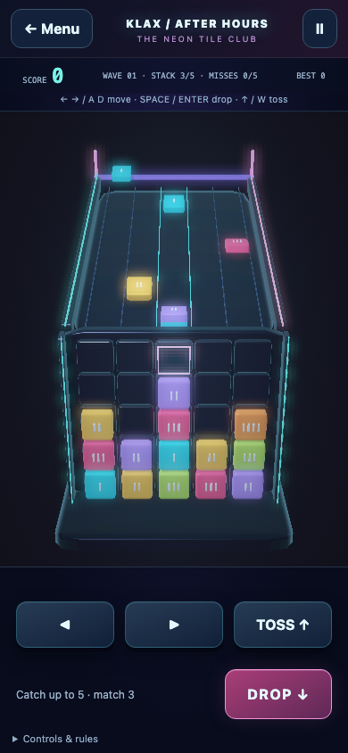

# HEAT STACK

An original falling-block game set in a ray-traced neon city. You stack and clear lines, build **heat**, grab **cash**, survive the **pursuit** and pull off the **getaway**. Everything is plain web standards, with no build step and no dependencies, so it runs the same way on a Mac, Android, any modern browser and a Raspberry Pi.

## Run it

```bash
python3 scripts/serve.py            # http://127.0.0.1:8137
python3 scripts/serve.py 8137 --lan # let phones / a Pi on your Wi-Fi connect
```

| Platform | How |
| --- | --- |
| **Mac** | Open it in Safari or Chrome. Safari: File › Add to Dock. Chrome: Install app. It runs full screen and offline. |
| **Android** | Open the LAN URL in Chrome, then choose **Install app**. Use touch gestures or the on-screen pad. Haptics work. |
| **Raspberry Pi 4/5** | `./scripts/pi-kiosk.sh` starts the server and Chromium in kiosk mode. On slow hardware the game lowers its own quality, down to Canvas 2D. |
| **Any browser** | Open the URL. A gamepad, keyboard or touch screen all work. |

Install and offline use need a secure context (`localhost`, or HTTPS when hosted).

## Open World (new)

Drive a GTA-style chase-cam car through one continuous world, ray-marched in real time with WebGL2:

- **Bryce Valley:** fractal mountains with snow caps, golden-hour sun, clouds, atmospheric haze, and Mirror Lake with rippled reflective water and floating chrome spheres. These are Bryce's signature looks.
- **Neon City:** a grid of towers with lit windows, neon trim and rooftop beacons.
- **Maya Studio:** an infinite grey grid floor with clay primitives (torus, sphere, cube, cone) and a red/green/blue transform gizmo, styled after Maya's viewport.

Driving works like this:
- Arcade physics on the same terrain the shader draws, with slopes, water and building collisions.
- A drift handbrake and a boost.
- A chase camera that dodges walls, can be orbited by dragging, and widens its field of view at speed.
- A rotating radar minimap and a speedometer.
- District name toasts and radio stations.
- **Wanted stars**, raised by speeding or crashing in the city and lost by laying low outside it.
- Cash pickups.

Drive into a glowing **job marker** to start a stacking job. When it's over, choose **Back to the streets** to return to your car.

| Drive | Keyboard | iPhone / Android | Gamepad |
| --- | --- | --- | --- |
| Gas / brake | W / S (↑ / ↓) | ▲ / ▼ | RT / LT |
| Steer | A / D (← / →) | ◀ ▶ | Left stick |
| Drift / boost | Space / Shift | DRIFT | A / B |
| Start job | E | Tap the prompt | X |
| Look around | Drag, wheel to zoom | Drag | Right stick |
| Camera / radio | V / R | 🎥 / 📻 | — |

## Board in 3D

- **Cameras:** the stacking board has four: Flat, 3D tilt, Cinematic orbit, and Free.
- **Free camera (Maya-style):** Alt+drag to tumble, Alt+middle-drag to track, Alt+right-drag or the scroll wheel to dolly, and **F** to frame the board.
- **On touch screens:** drag with two fingers to orbit and pinch to zoom.
- **Worlds:** two worlds for the board: Neon City (with a wet street that reflects the board) and Bryce Valley.
- **Street systems:**
  - Contacts phone in timed jobs, ending in MISSION PASSED or FAILED with cash and respect.
  - Respect builds a rank, from Street Rat up to Kingpin.
  - At 4★ a police-chopper searchlight sweeps the board.
  - Bribes cost run cash and drop a star.
  - Three radio stations (R key).

## What makes it different

- **Heat (0–5★).** Quads, T-spins, combos, back-to-backs, perfect clears and cash grabs build heat. Each star multiplies score by +30% and speeds gravity. At 3★ a pursuit meter starts raising roadblock rows. At 5★ a **GETAWAY** begins: clear 6 lines in 25 seconds to escape with a large bonus. Going quiet for 8 seconds cools the heat.
- **Cash and districts.** Some pieces carry a gold **$** mino. Clear its row to grab the cash. The amount you bank depends on how the run ends (100% for a rival win, 75% if you escaped, 50% if busted). Spend it to unlock five districts, each with its own block palette, skyline tint and accent colour.
- **Crew Rival.** An AI opponent plays the same seed in a **Web Worker** and trades garbage with you. It reacts to your emotes. There are three skill levels.
- **Crew emotions.** Your crewmate reacts to what happens in the run: hype, smug, nervous, shocked, angry, mind-blown, party or busted. Four emotes are on keys 1–4 or the emote buttons.
- **Social.** **Daily Heist** gives everyone the same daily seed. **Challenge links** carry your seed and score timeline, so a friend races your live **ghost** on identical pieces. **Photo mode** shares a branded screenshot through the Web Share API.

## Rendering engines

| Engine | Technique |
| --- | --- |
| **WebGPU** (WGSL) | Real ray tracing of the board's voxel grid using a DDA traversal. It casts a primary ray, a shadow ray toward the key light, and one reflection bounce. The procedural night city has two parallax skyline layers, plus sirens that follow the heat level. |
| **WebGL2** (GLSL ES 3.0) | The same tracer ported to GLSL, for browsers without WebGPU. |
| **Canvas 2D** | Cached bevelled block sprites and a pre-rendered city. Built for the Raspberry Pi and other low-power devices. |

**Auto** picks the best available engine. The adaptive governor then trades ray-tracing quality (reflections → shadows → primary only), then render scale, and finally falls back to Canvas 2D to hold the frame rate. You can override all of this in Settings.

## Platform tech used

ES modules, WebGPU, WebGL2, a module Web Worker, Web Audio (a synthesised adaptive soundtrack whose layers follow the heat), the Gamepad API (standard mapping plus rumble), Pointer Events gestures, the Vibration API, the Screen Wake Lock API, the Web Share API with files, a Service Worker for offline play, a Web App Manifest, and `prefers-reduced-motion`.

## Honest notes

- **Apple Neural Engine:** web pages can't target the Neural Engine directly. On Apple Silicon, WebGPU runs on the Apple GPU through Metal, and that's where the ray tracing happens. The rival AI is a fast heuristic search on its own CPU thread, not a neural network.
- **Bryce and Maya:** neither app can run inside a web page. The worlds recreate their signature looks (Bryce: fractal terrain, sky, water, chrome spheres; Maya: grid viewport, clay primitives, transform gizmo, Alt-key camera navigation) with the game's own shaders.
- The game uses genre mechanics only (open-world-crime-style heat, cash and getaways). It uses no names, art, music or characters from any existing game or franchise.

## Tests

```bash
node --test test/*.test.mjs   # Node 18+
```

## November 22, 2026 update

Choose **Midnight Getaway** for a separate 90-second driving challenge: follow the radar checkpoint, pass through all three markers, and earn $1,500. Gas, steering and brake are the same as Open World. The timer reports distance to your next checkpoint.

Choose **Revolutions 3D** for the stacking variant. Every line clear sends the camera all the way around the 3D board. Falling and piece input wait during the 2.2-second turn, then resume from the front. The board still uses the classic single-layer rules.

Phone calls disappear after 3.2 seconds. Banners replace each other and disappear after 1.8 seconds. Switching modes clears message overlays. The rotate controls sit above the separately labelled DROP button with about 100 pixels of vertical clearance on a 390×844 phone viewport.

### Driving and job return fix
Free driving begins on the flat eastbound road at the city entrance. Hill resistance is based on slope angle so the car can climb hills under normal throttle. The mountain route remains the starting point for Midnight Getaway.

Press **E** (or tap the marker prompt) to park exactly at a job marker and play an eight-line stacking job. Clear eight lines or end the run, and after a brief result message driving resumes automatically at the same position and heading. Wanted level, cash, pickups and camera state stay in the driving session.

## Klax-style Tile Ramp and Blockout-style 3D Pit

These are separate original game implementations with their own rules, controls and local high scores. They are available from the main menu and can be opened directly:

- Tile Ramp: https://cal2020.github.io/heat-stack/?arcade=tiles
- 3D Pit: https://cal2020.github.io/heat-stack/?arcade=pit

### Tile Ramp
Move the paddle left/right to catch incoming colored tiles. It holds five tiles in a stack. Drop the top tile into the selected bin column with Space/Down or **DROP**. Up or **TOSS** sends the top tile back up the ramp. Match at least three tiles horizontally, vertically, or diagonally; cleared tiles collapse and can create scoring cascades. Five misses or overflowing a bin ends the run. Five matches advance a wave.

### 3D Pit
Fit pieces made of solid voxels into a 5×5×12 well. A full 5×5 horizontal layer clears, and everything above it drops one layer. Pieces rotate about three independent axes, with collision checks and a landing outline. The game ends when another piece cannot enter the pit. WebGL renders the solid cubes; a software 3D fallback is available when WebGL is absent.

- Arrow keys or the directional pad move across the pit floor.
- Q/A rotate X forward/back, W/S rotate Y, E/D rotate Z. On touch screens use **X/Y/Z** and **Direction** to reverse rotation.
- Space or **DROP** instantly drops a piece. Its button has a separate row below rotation.
- Option-drag on Mac (Alt-drag elsewhere) or two-finger drag orbits the camera. Pinch or the mouse wheel zooms; **Reset view** restores the initial camera.
- Escape/P pauses; **Menu** returns to the main menu.

Each mode includes in-game rules, pause, restart and a separate local best score. Gamepads support movement and actions. In the pit, A/B/X rotate X/Y/Z and Y drops; in the tile game A drops and B tosses.

### Arcade screenshots





## Klax: After Hours — graphics and control overhaul

The Klax mode now uses an instanced WebGL scene: beveled tiles tumble along a lit ramp, cast shadows, and glow through a bloom pass. The cabinet shows the catch stack, highlights the selected lane, previews the landing cell, and animates dropped tiles and match particles. Tile pips supplement the colors. A software renderer remains available if WebGL is unavailable.

- Move: **← / →** or **A / D**, on-screen arrows, or tap/drag a lane.
- Drop: **Space**, **Enter**, **↓**, **S** or **J**.
- Toss back: **↑**, **W** or **K**.
- The first tile arrives over the starting paddle. The visible stack counter confirms catches. Trying to drop an empty stack explains what to do.
- Returning focus and pressing a gameplay key resumes a game paused by a window switch. Manual pauses still require Resume.

The former Right-button crash (movement being misrouted to rotation) is fixed for both arcade modes and covered by a regression test. Keyboard, mouse buttons, touch, focus recovery, and continued animation are checked in Chromium.
